# Vault observability lab

A 3-node HashiCorp Vault cluster with metrics, dashboards and a SIEM, started on a laptop with one command. Prometheus and Grafana watch the cluster, Wazuh reads the audit and server logs, a load generator keeps the graphs moving, and an incident script gives the SIEM something to find.

Built for practicing the monitoring, HA and audit topics of the Vault Operations Advanced exam, and for showing how Vault is watched in production.

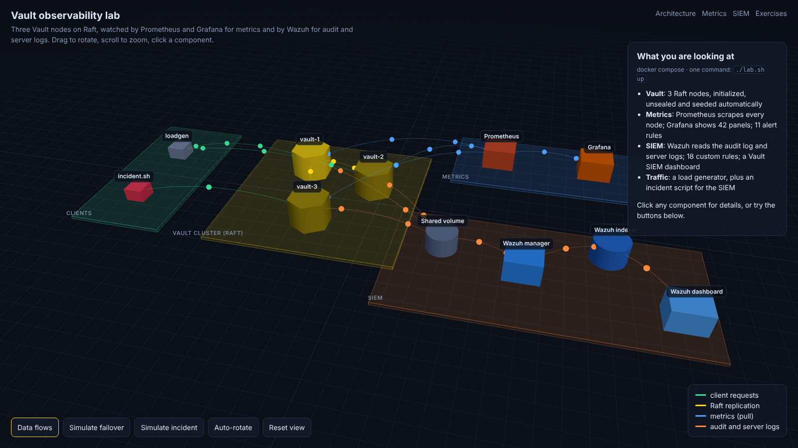

Interactive 3D view: [`docs/index.html`](docs/index.html) (rotate, zoom, click a component, simulate a failover or an incident). Publish it with GitHub Pages from the `docs/` folder, or run `cd docs && python3 -m http.server` and open http://localhost:8000.

## What you get

| | |
|---|---|
| Vault | 3 Raft nodes on 1.19.5, initialized, unsealed and seeded automatically; audit device and JSON server logs |
| Metrics | Prometheus scraping every node, 11 alert rules, a Grafana dashboard with 42 panels |
| SIEM | Wazuh manager, indexer and dashboard; 18 custom rules for Vault audit and server logs; a "Vault SIEM" dashboard |
| Traffic | Load generator (logins, KV, transit, tokens, quota bursts) and `./lab.sh incident` |
| Upgrades | `./lab.sh upgrade <version>`: rolling upgrade, standbys first, active node last, snapshot and health gates; an Ansible playbook for real servers |
| Multi-cloud | `./lab.sh multicloud up` adds a second independent cluster; Terraform applies one baseline to both and detects drift; Grafana and Wazuh show both |
| Docs | [Accessing Vault](docs/access.md), [Multi-cloud](docs/multicloud.md), [Architecture](docs/architecture.md), [Metrics](docs/metrics.md), [SIEM](docs/siem.md), [Upgrades](docs/upgrades.md), [Exercises](docs/exercises.md), [Troubleshooting](docs/troubleshooting.md) |

## Screenshots

All taken from a running lab.

| Grafana: Vault overview | Wazuh: Vault SIEM |
|---|---|
| 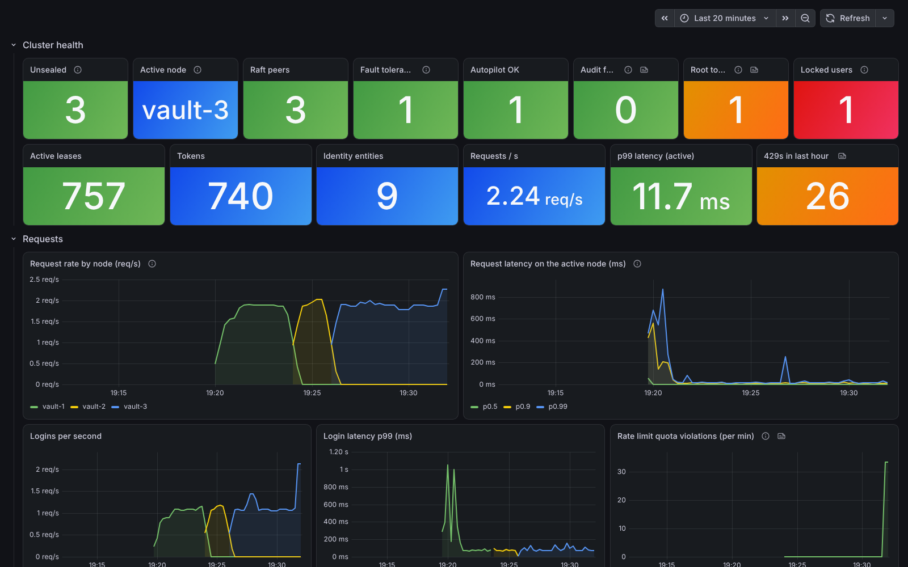 | 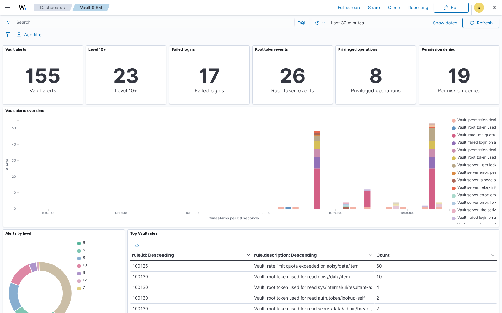 |
| Grafana: Raft storage and runtime | Wazuh: level 9+ findings after `./lab.sh incident` |
| 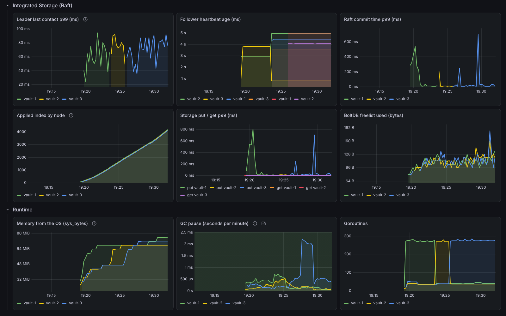 | 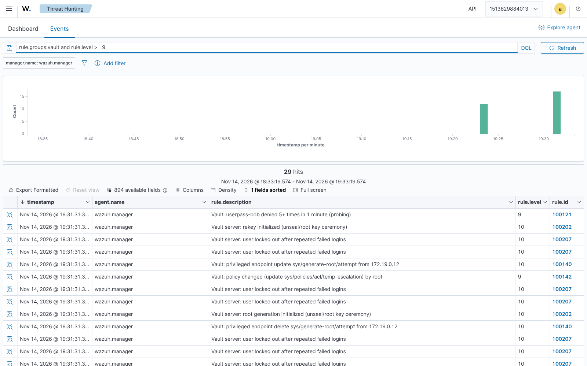 |
| Prometheus: every node scraped, standbys included | Prometheus: alert rules |
| 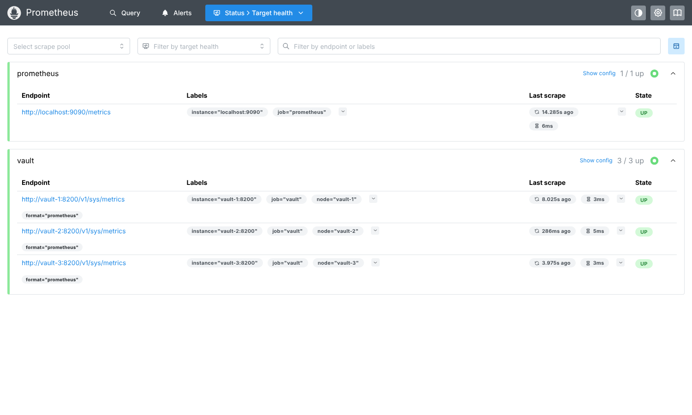 | 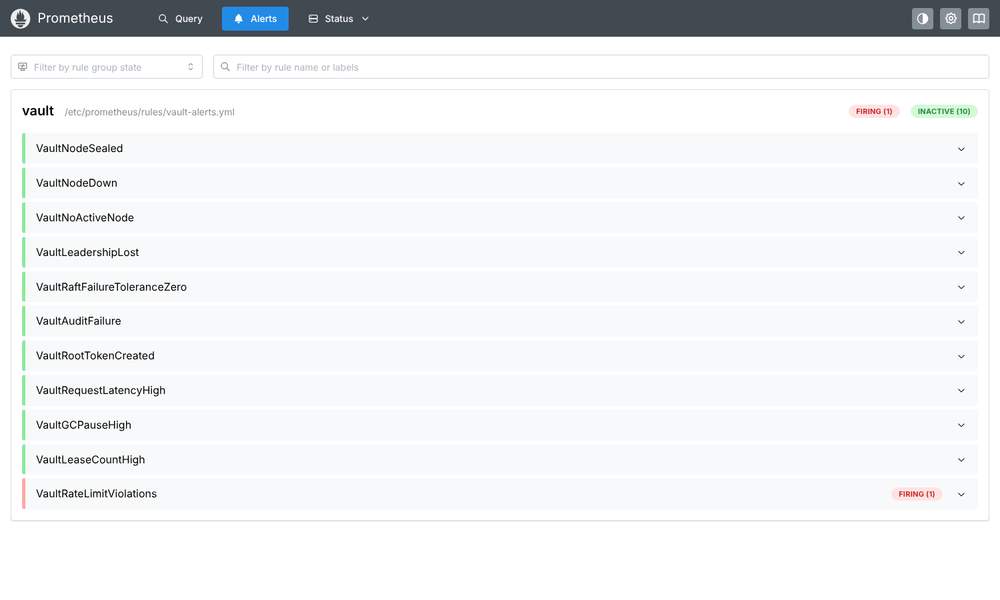 |
| Vault UI: Raft peers | The helper script |
| 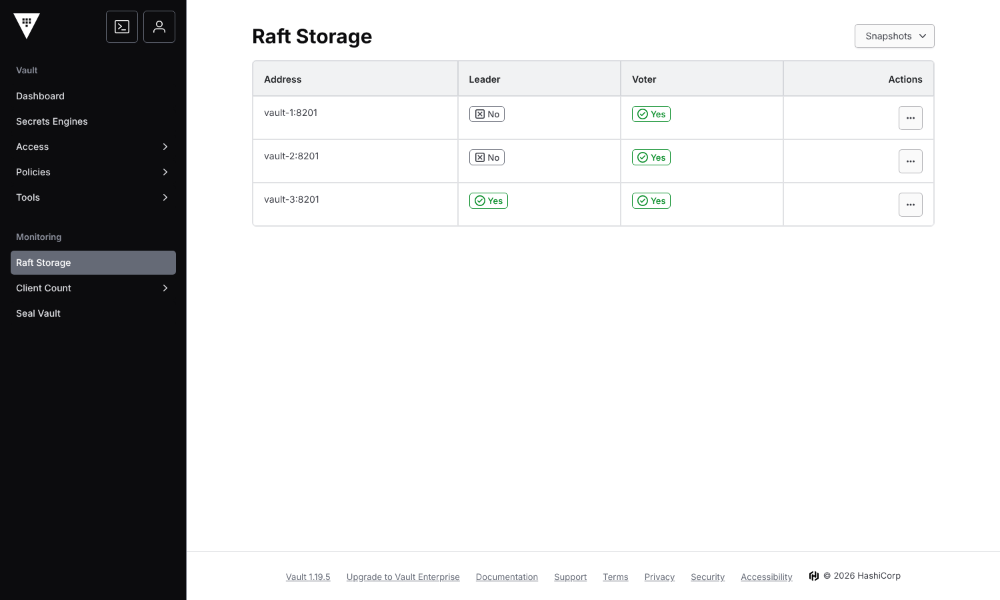 | 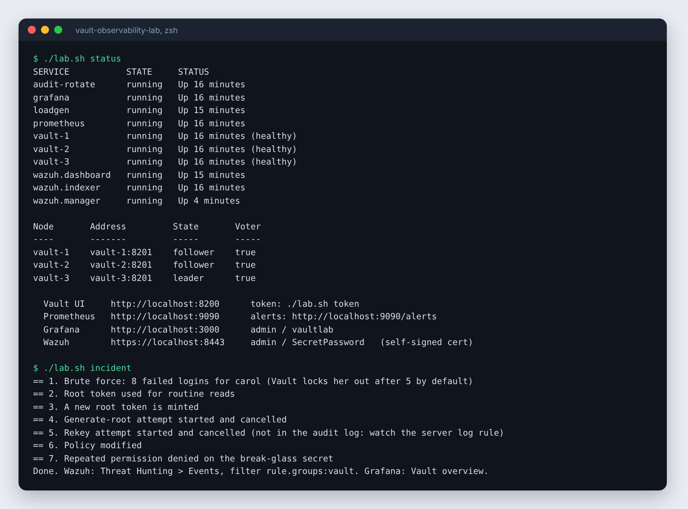 |

## Quick start

Requirements: Docker Desktop (Mac, Windows) or Docker Engine with Compose (Linux), at least 6 GB of memory for Docker, about 6 GB of disk. Intel and Apple Silicon both work. On Linux also run `sudo sysctl -w vm.max_map_count=262144`.

```bash
git clone https://github.com/flavioimbertdomingos/vault-observability-lab.git
cd vault-observability-lab
./lab.sh up          # first run: 3 to 6 minutes
./lab.sh status
./lab.sh incident    # then open Wazuh > Dashboards > Vault SIEM
```

| Service | URL | Login |
|---|---|---|
| Vault | http://localhost:8200 | `./lab.sh token` |
| Prometheus | http://localhost:9090 | none |
| Grafana | http://localhost:3000 | admin / vaultlab |
| Wazuh | https://localhost:8443 | admin / SecretPassword |

Ports are checked before starting. To move one, `cp .env.example .env` and edit it.

Less memory? `./lab.sh core` runs Vault, Prometheus and Grafana only (about 1 GB).

| Command | Does |
|---|---|
| `./lab.sh up` | Start everything; unseals Vault on later runs |
| `./lab.sh core` | Start without Wazuh |
| `./lab.sh status` | Containers, Raft peers, URLs |
| `./lab.sh incident` | Simulated attack for the SIEM |
| `./lab.sh unseal` | Unseal after Docker restarts |
| `./lab.sh dashboards` | Re-import the Wazuh dashboard |
| `./lab.sh token` | Print the root token |
| `./lab.sh versions` | Version and role of each node |
| `./lab.sh snapshot` | Raft snapshot to `backups/` |
| `./lab.sh upgrade 1.20.4` | Rolling upgrade, no downtime for clients behind a health-checked load balancer |
| `./lab.sh multicloud up` | Start cloud-b, a second independent cluster on 8300-8320 |
| `./lab.sh tf plan` / `apply` | Terraform baseline on both clusters, drift detection |
| `./lab.sh token b` | Root token of cloud-b |
| `./lab.sh down` | Stop, keep data |
| `./lab.sh reset` | Delete all data, secrets and certificates |

## Accessing Vault

Every node has its own port: vault-1 on 8200, vault-2 on 8210, vault-3 on 8220.

```bash
# CLI on your machine (macOS: brew tap hashicorp/tap && brew install hashicorp/tap/vault)
export VAULT_ADDR=http://localhost:8200
export VAULT_TOKEN=$(./lab.sh token)
vault status
vault operator raft list-peers

# or a user instead of root
unset VAULT_TOKEN
vault login -method=userpass username=alice password=alice-pass

# or the CLI inside a container
docker compose exec -e VAULT_TOKEN=$(./lab.sh token) vault-2 vault status
```

The web UI is at http://localhost:8200 (token from `./lab.sh token`, or alice / alice-pass). All options, credentials and first commands: [docs/access.md](docs/access.md).

## How it works

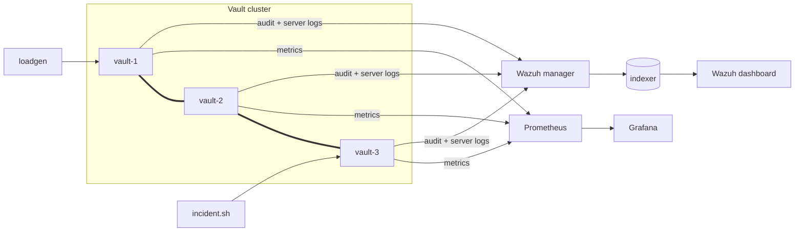

- Prometheus pulls `/v1/sys/metrics?format=prometheus` from each node directly, so standbys are visible.
- The file audit device and per-node JSON server logs share one volume that the Wazuh manager reads.
- Normal traffic is decoded at level 0 and never indexed; only findings become alerts.

Details in [docs/architecture.md](docs/architecture.md).

## Findings worth knowing

Testing the rules against real Vault 1.19 logs turned up a few things the docs do not spell out:

- Rekey requests never reach the audit log because the endpoints are unauthenticated. The server log records them.
- `sys/step-down` writes a request line but no response line.
- Requests rejected by a rate limit quota (429) are audited only with `enable_rate_limit_audit_logging=true`.
- Userpass lockout (5 failures in 15 minutes by default) shows up only in the server log and in `vault_core_locked_users`.
- Usage gauges such as `vault_token_count` come from the active node only, once per `usage_gauge_period`.

More in [docs/siem.md](docs/siem.md) and [docs/metrics.md](docs/metrics.md).

## Rolling upgrades without Enterprise

```bash
./lab.sh versions
./lab.sh upgrade 1.20.4
```

Community Edition has no automated upgrades and no replication, but a 3-node Raft cluster can still be upgraded one node at a time without losing data. `./lab.sh upgrade` does it with a snapshot first and autopilot health checks between nodes. In the lab, 1.20.4 to 1.21.4 took 66 seconds; a probe reading from every node saw failures only on the node being restarted and none during the leader change. [`ansible/vault-rolling-upgrade`](ansible/vault-rolling-upgrade/README.md) runs the same procedure on real servers and can be practised against the lab. Procedure, measured results, rollback, the Ansible playbook and the Community vs. Enterprise comparison: [docs/upgrades.md](docs/upgrades.md).

## Multi-cloud

One Raft cluster belongs in one region of one cloud; stretching a quorum across clouds is the pattern to avoid. Without Enterprise replication, the practical multi-cloud design is an independent cluster per cloud, configured identically from code. The lab shows it:

```bash
./lab.sh multicloud up      # cloud-b: vaultb-1..3 on ports 8300, 8310, 8320
./lab.sh tf apply           # same mounts, policies, AppRole and quota on both clusters
./lab.sh tf plan            # a manual change on either cluster shows up as drift
```

| Grafana: both clusters side by side | Terraform finds a hand-edited policy on cloud-b |
|---|---|
| 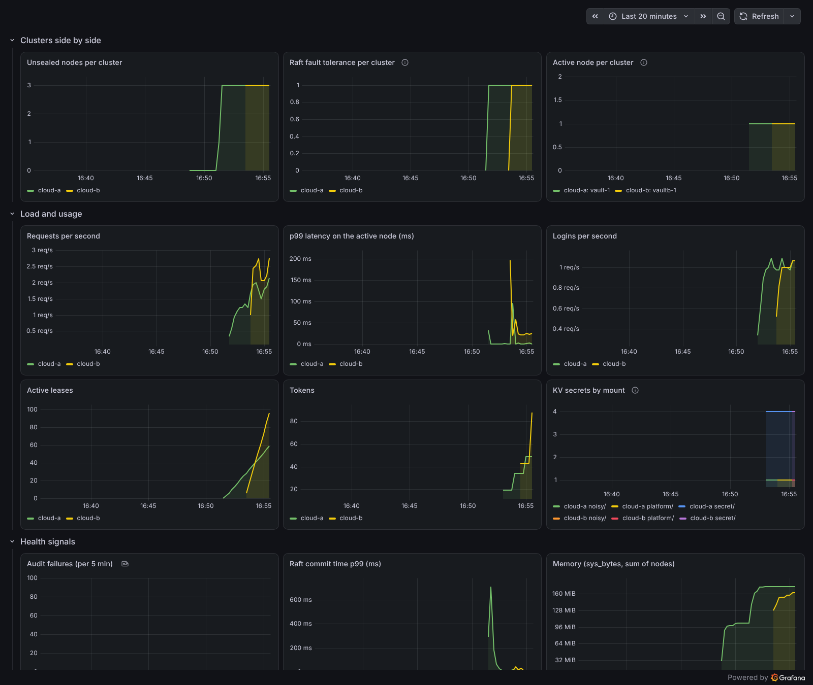 | 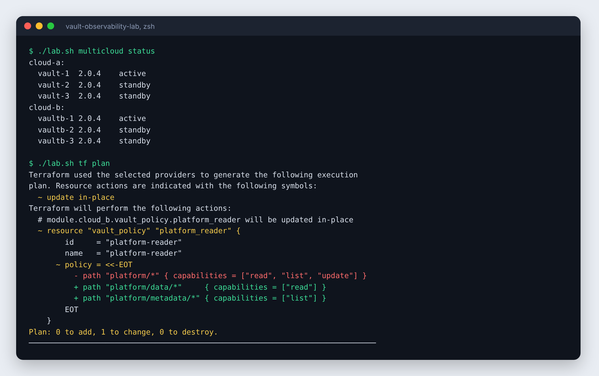 |

Patterns compared (central cluster, independent clusters, stretched Raft, Enterprise replication), the Terraform layout, monitoring several clusters and where this design stops: [docs/multicloud.md](docs/multicloud.md).

## Exercises

Failover, incident response, rate limits, lease growth, Raft quorum, audit HMAC search, planned leader change, writing your own detection, rolling upgrade, multi-cloud drift. See [docs/exercises.md](docs/exercises.md).

## Lab only

This is a learning environment. Do not copy these settings to production:

- Vault TLS is off and metrics are unauthenticated.
- One unseal key, threshold 1, root token stored in `secrets/init.json` (git-ignored).
- Wazuh uses its stock demo passwords and a self-signed CA generated by `wazuh/gen-certs.sh`.
- Wazuh vulnerability detection is off (its feed is about 8 GB).

## Versions

Vault 1.19.5, Prometheus 3.16.0, Grafana 13.2.6, Wazuh 4.14.10. Override with `VAULT_VERSION`, `PROMETHEUS_VERSION`, `GRAFANA_VERSION`, `WAZUH_VERSION` in `.env`.

## License

Lab code and documentation: MIT, see [LICENSE](LICENSE). The Wazuh configuration files under `wazuh/config/` are adapted from [wazuh/wazuh-docker](https://github.com/wazuh/wazuh-docker) and stay under GPLv2. three.js in `docs/vendor/` is MIT. See [NOTICE](NOTICE).
