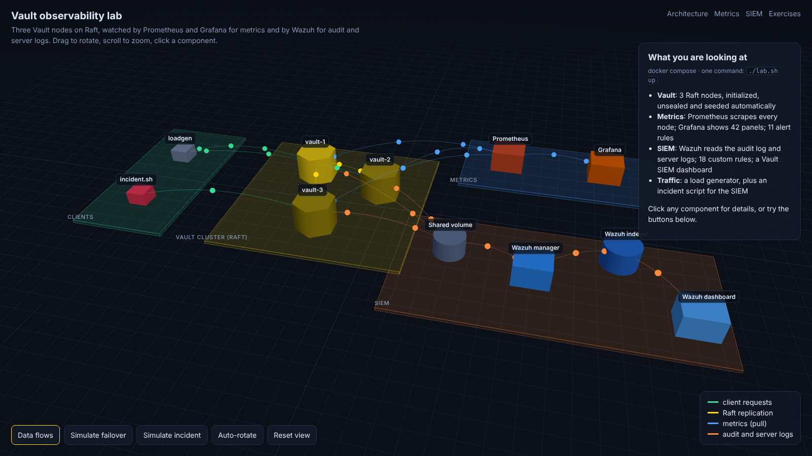
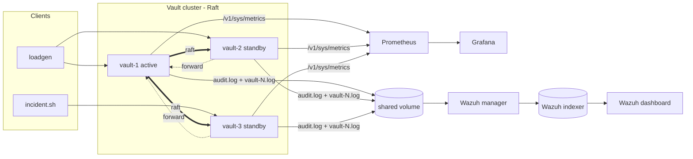

# Architecture

[Back to README](../README.md) · [Access](access.md) · [3D view](index.html) · [Metrics](metrics.md) · [SIEM](siem.md) · [Upgrades](upgrades.md) · [Multi-cloud](multicloud.md) · [Terraform](terraform.md) · [IaC pipeline](iac.md) · [OIDC](oidc.md) · [Exercises](exercises.md) · [Troubleshooting](troubleshooting.md)



The interactive version is `docs/index.html` (rotate, zoom, click a component, simulate a failover or an incident). Open it through GitHub Pages or any local web server: `cd docs && python3 -m http.server`, then http://localhost:8000.

## Components

| Service | Image | Host port | Role |
|---|---|---|---|
| vault-1, vault-2, vault-3 | hashicorp/vault:1.19.5 | 8200, 8210, 8220 | Raft cluster with Integrated Storage, one active node and two standbys |
| vault-init | hashicorp/vault:1.19.5 | none | One-shot: initializes on the first run, unseals on every run, seeds config |
| loadgen | hashicorp/vault:1.19.5 | none | Background traffic every 3 seconds |
| audit-rotate | hashicorp/vault:1.19.5 | none | Copy and truncate of `audit.log` above 200 MB |
| prometheus | quay.io/prometheus/prometheus:v3.16.0 | 9090 | Scrapes all nodes, evaluates alert rules |
| grafana | grafana/grafana:13.2.6 | 3000 | "Vault overview" dashboard, provisioned |
| wazuh.manager | wazuh/wazuh-manager:4.14.10 | 1514, 1515 | Reads Vault logs, applies the rules, ships alerts |
| wazuh.indexer | wazuh/wazuh-indexer:4.14.10 | none | Stores alerts (OpenSearch) |
| wazuh.dashboard | wazuh/wazuh-dashboard:4.14.10 | 8443 | Threat Hunting and the "Vault SIEM" dashboard |

Every image is published for amd64 and arm64. All host ports can be changed in `.env` (see `.env.example`).

## Data flows



1. Requests. Clients hit any node. Standbys forward to the active node, which writes to Raft and replicates to the followers.
2. Metrics. Prometheus pulls `/v1/sys/metrics?format=prometheus` from each node every 15 seconds, directly, not through a load balancer, so standbys are visible too.
3. Logs. The file audit device and the three server logs live on one Docker volume. The Wazuh manager mounts it read-only and reads both as JSON.

## Startup sequence

`./lab.sh up` runs these steps:

1. Checks that the host ports are free and names the program holding any that are not.
2. Creates the Wazuh certificates on the first run (`wazuh/gen-certs.sh`, plain openssl, works offline).
3. Starts the three Vault nodes. They wait sealed, each with `retry_join` pointing at the other two.
4. `vault-init` initializes vault-1 (first run only), unseals vault-1, vault-2 and vault-3, waits for a Raft leader, then seeds the configuration (first run only):
   - file audit device, mode 0640
   - KV v2 at `secret/`, KV v2 at `noisy/` with a 5 req/s rate limit quota, transit key `payments`
   - userpass users alice, bob, carol; AppRole role `web`; policies `app` and `loadgen`
   - `enable_rate_limit_audit_logging=true`
5. The Wazuh manager starts after `vault-init` completes, so the audit log already exists when the log collector opens it.
6. `lab.sh` waits for the Wazuh dashboard and imports the "Vault SIEM" saved objects.

Restarting is safe: `vault-init` sees the cluster is initialized and only unseals.

## Design decisions

| Decision | Why |
|---|---|
| Three voters | Smallest cluster that survives one node failure. Autopilot fault tolerance is 1. |
| `unauthenticated_metrics_access = true` | Lets standbys answer `/v1/sys/metrics`. Production should use a token with `read` on `sys/metrics`. |
| Per-node `log_file` in JSON | Some events never reach the audit log because the endpoints are unauthenticated (rekey). The server log catches them. |
| Shared log volume, no agent | The manager reads the files itself (agent 000). Fewer moving parts for a lab. |
| Level 0 for normal traffic | Every request is decoded, only findings are indexed. Disk stays small. |
| `enable_rate_limit_audit_logging` | Without it, 429s are invisible to the SIEM. |
| Vulnerability detection off | The feed is about 8 GB and there are no agents to scan. |
| Generators for dashboards | `grafana/build_dashboard.py` and `wazuh/build_dashboard.py` produce the JSON, so changes are code-reviewed instead of exported by hand. |

## Files

```
docker-compose.yml            all services
lab.sh                        helper commands (up, core, status, incident, unseal, dashboards, token, versions, snapshot, upgrade, multicloud, tf, down, reset)
.env.example                  ports and other overrides
vault/config/vault.hcl        shared server config: Raft, listener, telemetry
vault/nodes/vault-N.hcl       per-node log file
vault/scripts/init.sh         init, unseal, seed
vault/scripts/loadgen.sh      background traffic
vault/scripts/incident.sh     simulated attack
prometheus/prometheus.yml     scrape config
prometheus/rules/             alert rules
grafana/                      provisioning, dashboard JSON and its generator
wazuh/gen-certs.sh            offline certificate generator
wazuh/config/                 manager, indexer and dashboard config (adapted from wazuh-docker)
wazuh/rules/vault_rules.xml   Vault rules
wazuh/*.ndjson                Vault SIEM dashboard and index pattern
terraform/multicloud          Terraform baseline applied to cloud-a and cloud-b
vault/config/vault-b.hcl      config of the optional second cluster (cloud-b)
prometheus/targets/           scrape targets for cloud-b, written by ./lab.sh multicloud
ansible/vault-rolling-upgrade Ansible rolling upgrade for real servers (and the lab)
backups/                      Raft snapshots from ./lab.sh snapshot and upgrade (git-ignored)
docs/                         this documentation and the 3D view
secrets/                      created on the first run (git-ignored)
```
