# Vault configuration as code: pull requests, approval, apply

[Back to README](../README.md) · [Terraform](terraform.md) · [OIDC](oidc.md) · [Multi-cloud](multicloud.md) · [Exercises](exercises.md) · [Troubleshooting](troubleshooting.md)

## What you will build

After this guide, nobody changes the lab's Vault configuration by hand. A change is a pull request. GitHub checks it, a job on a runner inside your lab shows the Terraform plan on the pull request, and after the merge the change waits until someone approves it. Only then does Terraform apply it. Every night a job compares Vault with the code and opens an issue if they differ.

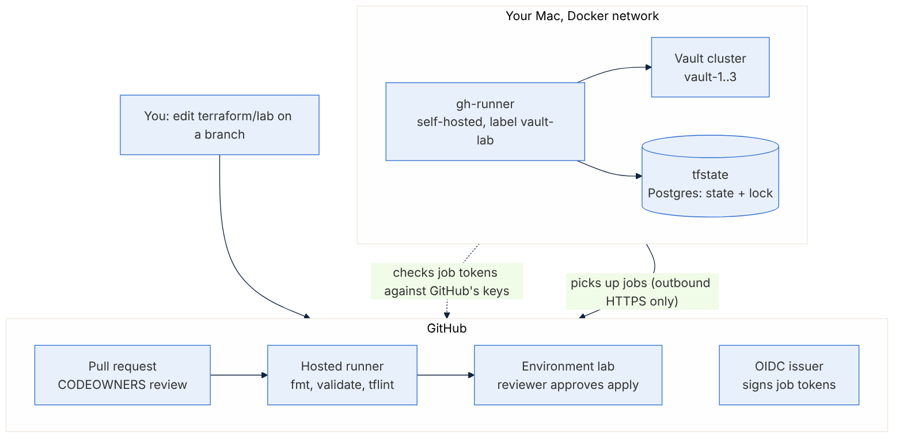

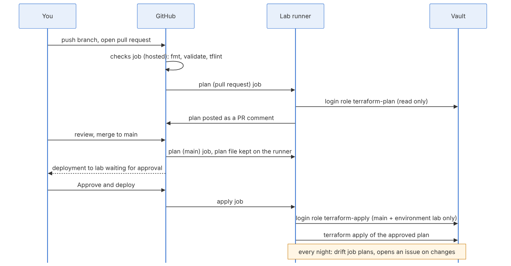

### What the repository now contains

| Path | What it is |
|---|---|
| `terraform/lab/` | The configuration the pipeline owns: one KV mount, two policies and one AppRole role per team, listed in `teams.tf` |
| `.github/workflows/vault-iac.yml` | The pipeline: checks, plan on pull requests, plan and approved apply on main, nightly drift check |
| `.github/actions/vault-login/` | Exchanges the job's GitHub OIDC token for a 15-minute Vault token |
| `.github/CODEOWNERS` | Who must review changes to Terraform, the pipeline and the detection rules |
| `iac/bootstrap-vault.sh` | One-time setup in Vault: the JWT auth method and the two roles the pipeline logs in with |
| `iac/terraform-plan-policy.hcl` | Read-only policy for every plan |
| `terraform/terraform-policy.hcl` | Write policy, used only by the approved apply job |
| `iac/runner-entrypoint.sh` | Starts and registers the self-hosted runner container |
| `docker-compose.yml`, profile `iac` | Two new containers: `tfstate` (Postgres for Terraform state) and `gh-runner` |
| `./lab.sh iac up / runner / status / down` | Starts and bootstraps all of it |

### Two identities, two policies

The heart of the design is that a plan and an apply are different identities in Vault. GitHub signs a token for every job that says which repository, branch and environment it runs for. Vault's JWT auth method checks the signature with GitHub's public keys and only issues a token when the claims match the role.

| Vault role | Who can get it | Policy | Can do |
|---|---|---|---|
| `terraform-plan` | Any job of `FlavioImbertDomingos/vault-observability-lab` | `terraform-plan` | Read and list the configuration. A plan, nothing more |
| `terraform-apply` | Only a job on `refs/heads/main` that runs in the GitHub environment `lab` | `terraform` | Create, change and delete the mounts, policies and roles Terraform owns |

The environment `lab` has a required reviewer. So the only way to get a write token is a merged change that someone approved. A pull request from a fork never reaches the lab runner, and even if it did, its token names a different repository.

## Before you start

You need:

- the lab running: `./lab.sh up` (or `./lab.sh core`, the pipeline needs only Vault)
- the latest code: `git pull` in `Vault-Observability-Lab`
- admin rights on the GitHub repository
- optional: the GitHub CLI (`brew install gh`, then `gh auth login`); every step also works in the browser
- optional: `jq` for reading the audit log (`brew install jq`)

The order matters. Configure GitHub first, so the very first pipeline run already waits for your approval. Push the code last.

| Step | Where | Time |
|---|---|---|
| 1. Create the `lab` environment with you as reviewer | GitHub | 3 min |
| 2. Lock down workflows from forks | GitHub | 1 min |
| 3. Start the state database and bootstrap Vault | Mac | 2 min |
| 4. Register the runner | GitHub + Mac | 3 min |
| 5. Push the code; approve the first deployment | Mac + GitHub | 5 min |
| 6. Protect the main branch | GitHub | 3 min |
| 7. Your first change: add a team | Mac + GitHub | 10 min |
| 8. Exercises: rejected change, local apply, drift, audit | Mac + GitHub | 20 min |

## Step 1: the lab environment (the approval gate)

An environment is GitHub's deployment target. A job that names `environment: lab` stops before its first step until a required reviewer approves it.

1. Open the repository on GitHub and click **Settings**.
2. In the left menu click **Environments**, then **New environment**.
3. Name it `lab` (lowercase, exactly) and click **Configure environment**.
4. Tick **Required reviewers** and add yourself (`FlavioImbertDomingos`).
5. Leave **Prevent self-review** unticked. You work alone, so you are the reviewer of your own changes. In a company this box is ticked and the reviewer is someone else, for example the security team.
6. Under **Deployment branches and tags** choose **Selected branches and tags**, click **Add deployment branch or tag rule** and enter `main`.
7. Click **Save protection rules**.

With the GitHub CLI you can check the result:

```bash
gh api repos/FlavioImbertDomingos/vault-observability-lab/environments/lab \
  --jq '{name, protection_rules: [.protection_rules[].type]}'
# {"name":"lab","protection_rules":["required_reviewers","branch_policy"]}
```

Do this before step 5. A job that names an environment which does not exist yet creates it, without any reviewer, and would apply without asking.

## Step 2: workflows from forks

The repository is public, and the runner sits on your Mac. GitHub's own guidance is not to let pull requests from strangers run on a self-hosted runner. The workflow already refuses: lab jobs run only for branches of this repository. Add the repository setting as a second lock.

1. **Settings > Actions > General**.
2. Under **Approval for running fork pull request workflows from contributors**, choose the strictest option (require approval for all external contributors).
3. Under **Workflow permissions**, choose **Read repository contents and packages permissions**. Each job in the workflow asks for the extra permissions it needs (posting a comment, opening an issue, requesting an OIDC token).
4. Click **Save**.

Create the label the drift job uses:

```bash
gh label create drift --color B60205 --description "Vault differs from terraform/lab"
```

(or **Issues > Labels > New label**, name `drift`).

## Step 3: state database and Vault bootstrap

```bash
cd ~/Documents/"Hashicorp Vault"/Vault-Observability-Lab
./lab.sh iac up
```

This starts `tfstate` (Postgres) and runs `iac/bootstrap-vault.sh` inside vault-1 with the root token. It is the one part that cannot come from the pipeline: something has to create the identity the pipeline logs in with. In a company this is a recorded break-glass step.

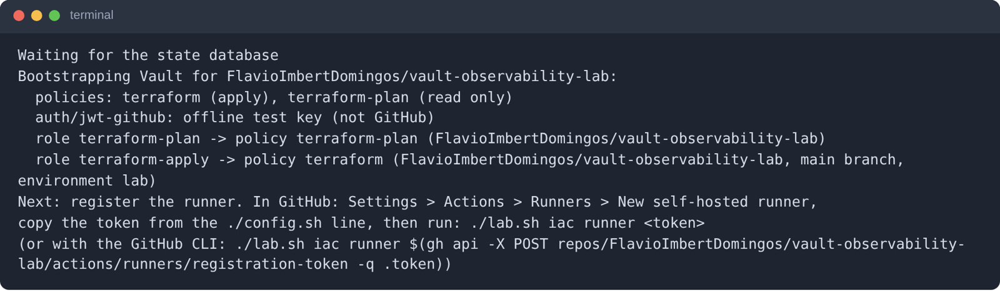

Check what was created:

```bash
export VAULT_ADDR=http://localhost:8200 VAULT_TOKEN=$(./lab.sh token)
vault read auth/jwt-github/role/terraform-apply
vault policy read terraform-plan
```

If your fork of the repository has another name, set it before running `iac up`: put `GITHUB_REPO=owner/repo` in `.env`.

## Step 4: register the runner

1. **Settings > Actions > Runners > New self-hosted runner**.
2. Choose **Linux** and the architecture of your Mac: **ARM64** for Apple silicon, **x64** for Intel. (The container is Linux, whatever the Mac is.)
3. Ignore the download commands. In the **Configure** box, copy the value after `--token` in the `./config.sh` line. It is valid for one hour.
4. On the Mac:

```bash
./lab.sh iac runner <the token>
# Registering....
# Runner online: GitHub > Settings > Actions > Runners shows vault-lab as Idle.
```

Or in one line with the GitHub CLI:

```bash
./lab.sh iac runner $(gh api -X POST \
  repos/FlavioImbertDomingos/vault-observability-lab/actions/runners/registration-token -q .token)
```

Back in **Settings > Actions > Runners** you see `vault-lab` with the labels `self-hosted`, `Linux`, `ARM64` (or `X64`) and `vault-lab`, status **Idle**. The registration is kept in the `gh-runner` Docker volume; after `./lab.sh down` and `up`, `./lab.sh iac up` starts the runner again without a new token.

## Step 5: push and approve the first deployment

```bash
git add -A
git commit -m "IaC pipeline: GitHub Actions, OIDC login to Vault, approval before apply"
git push
```

The push touches `terraform/lab/`, so the workflow starts:

1. Open **Actions > vault-iac**. The run shows `plan (main)` running on `vault-lab`, then `apply (after approval)` with the status **Waiting**.
2. Click the run. The summary at the top shows the plan: `Plan: 9 to add` (the `approle-teams` auth method, and the mount, two policies and AppRole role of `payments` and `orders`).
3. Click **Review deployments**, tick **lab**, add a comment if you like, then **Approve and deploy**.
4. The apply job logs in as `terraform-apply`, applies exactly the plan you read, and finishes with `Apply complete! Resources: 9 added`.

Check in Vault:

```bash
vault secrets list | grep team-
vault list auth/approle-teams/role
vault policy read team-payments-read
```

GitHub keeps the approval: **Actions > vault-iac > the run** shows who approved and when, and **Settings > Environments > lab** lists every deployment.

## Step 6: protect main

Now that the code is in, stop direct pushes so every change goes through a pull request.

1. **Settings > Rules > Rulesets > New ruleset > New branch ruleset**.
2. Name: `main`. Enforcement status: **Active**.
3. Target branches: **Add target > Include default branch**.
4. Tick **Restrict deletions** and **Block force pushes**.
5. Tick **Require a pull request before merging**. Required approvals: **0** while you work alone (GitHub does not let you approve your own pull request). In a company set it to 1 or more and tick **Require review from Code Owners**.
6. Tick **Require status checks to pass**, click **Add checks** and add `fmt, validate, lint` and `plan (pull request)`. They appear in the list after they ran once, which happens in step 7; come back then if the list is empty. The workflow runs on every pull request so these checks always report; for pull requests that do not touch `terraform/lab` the plan simply shows no changes. The runner has to be online for `plan (pull request)` to pass.
7. Click **Create**.

From now on `git push` to main is refused. That is the point.

## Step 7: your first change, add a team

```bash
git checkout -b add-inventory-team
```

Edit `terraform/lab/teams.tf` and add one entry:

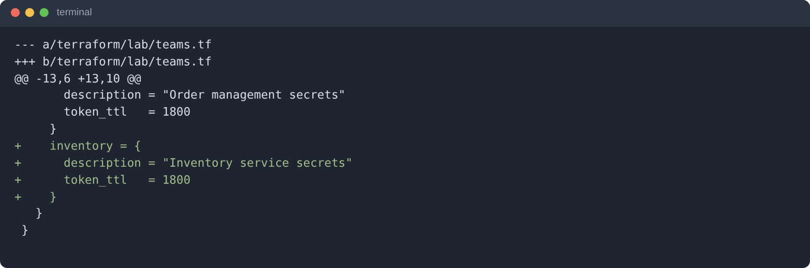

```bash
git commit -am "Add the inventory team"
git push -u origin add-inventory-team
gh pr create --fill        # or open the pull request in the browser
```

On the pull request:

1. The checks start. `fmt, validate, lint` runs on a GitHub-hosted machine; it has no way into your lab.
2. `plan (pull request)` runs on `vault-lab`, logs in as `terraform-plan` and posts the plan as a comment. Edit the branch and push again, and the same comment is updated.

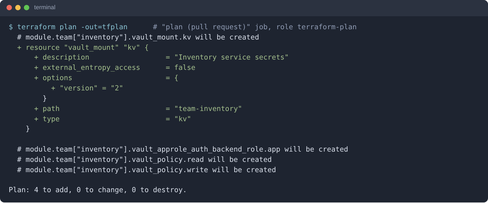

3. Read the plan as a reviewer would: four resources added, nothing changed, nothing destroyed. Then **Squash and merge**.
4. The push to main starts `plan (main)` and then `apply`, which waits for you. **Review deployments > lab > Approve and deploy**.

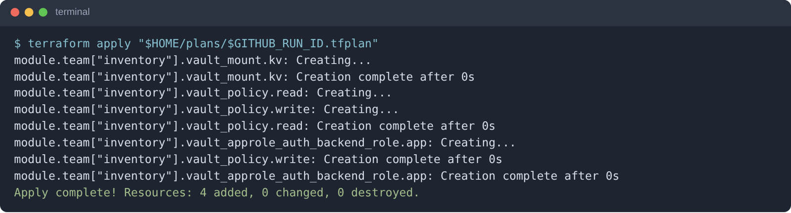

5. Check: `vault secrets list | grep team-inventory`.

Why a saved plan: the apply job applies the plan file the `plan (main)` job wrote, not a fresh plan. If anything changed the state between the plan you read and the apply, Terraform refuses:

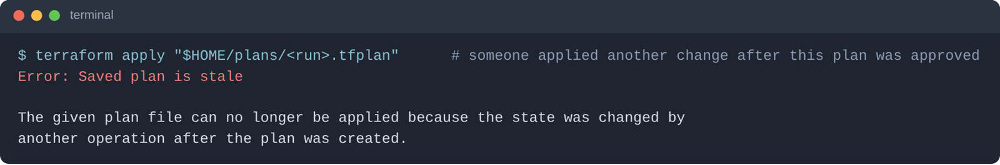

## Step 8: exercises

### 8.1 A change the pipeline rejects

The team module has rules: names in lowercase, application tokens between 5 minutes and 4 hours. On a new branch, set `token_ttl = 86400` for a team and open a pull request. The plan job fails and nothing can be merged.

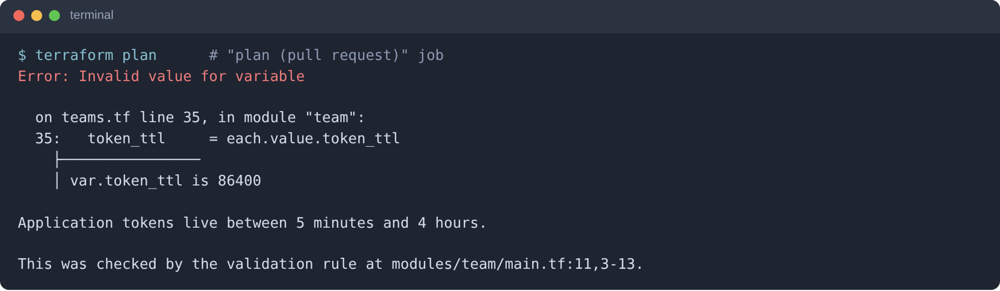

### 8.2 Applying from your laptop does not work

`./lab.sh tf lab plan` works on your Mac, so you can try changes before opening a pull request. `apply` does not: `./lab.sh tf lab` gets a `terraform-plan` token, and every write is refused.

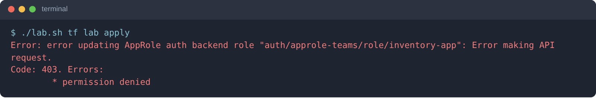

This is the rule many companies enforce: people can see and plan, only the pipeline can change.

### 8.3 Drift: someone changes Vault by hand

With the root token, loosen a team policy:

```bash
echo 'path "team-payments/*" { capabilities = ["read", "list", "sudo"] }' \
  | vault policy write team-payments-read -
```

Do not wait for the night: **Actions > vault-iac > Run workflow**, mode **drift**, **Run workflow**. The drift job plans with the read-only role, finds the difference and opens an issue labelled `drift`.

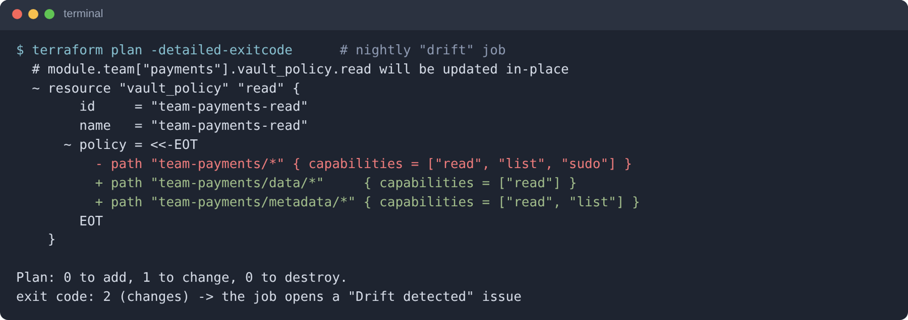

To put Vault back: **Run workflow**, mode **apply**, then approve the deployment. Close the issue with a note on who made the change and why. If the change was right, it belongs in `terraform/lab` through a pull request instead.

### 8.4 Who changed Vault?

Every request the apply job makes is in the audit log, with the GitHub user, commit, workflow and run id copied from the job's token:

```bash
docker compose exec -T vault-1 cat /vault/logs/audit.log \
  | jq -c 'select(.type=="request" and (.request.path|startswith("sys/mounts/team-")))
           | {time, op: .request.operation, path: .request.path,
              who: .auth.display_name, meta: .auth.metadata}'
```

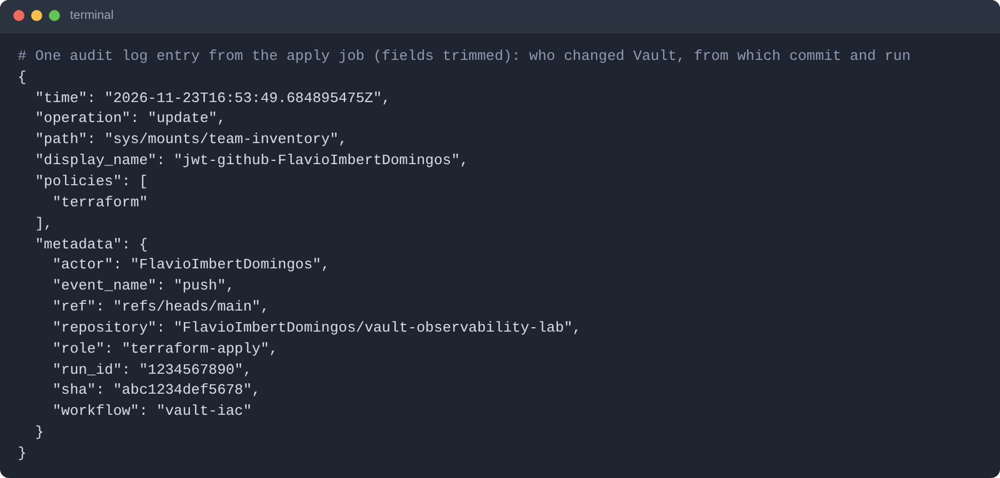

A request made with the root token shows `"display_name": "root"` and no metadata, which is exactly what the drift issue asks you to explain.

### 8.5 The login rules, tested

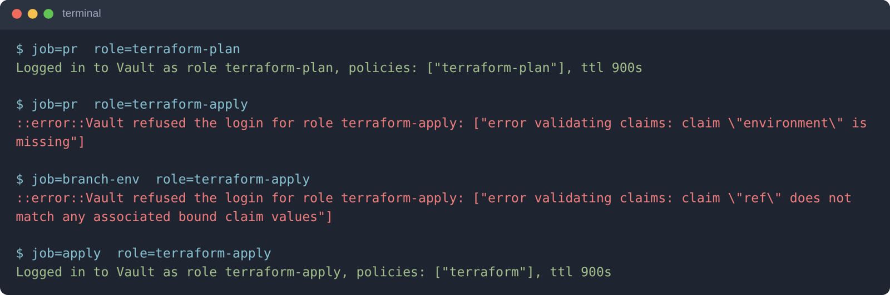

## How this maps to an enterprise

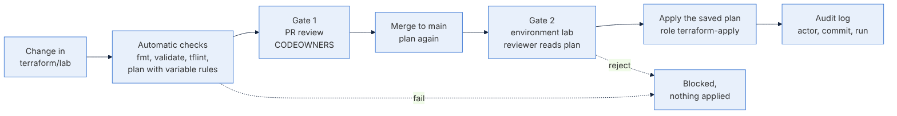

| In the lab | In a company |
|---|---|
| Pull request, CODEOWNERS, ruleset on main | Same, with 1 or 2 required approvals and code owner review |
| Environment `lab` with you as reviewer | Environment per stage (dev, test, prod), reviewers from change management or security, prevent self-review on |
| Plan comment on the pull request | Same, or HCP Terraform / Atlantis showing the plan |
| Variable rules in the module | Policy as code: OPA/conftest or Sentinel (HCP Terraform), plus Checkov or tfsec |
| Self-hosted runner in Docker | Private runners or HCP Terraform agents inside the network |
| GitHub OIDC to Vault JWT auth | Same; also OIDC to AWS, Azure, GCP for cloud changes |
| `terraform-plan` vs `terraform` policies | Same split; humans get read-only access to production configuration |
| Postgres state with locking | S3 + DynamoDB or S3 native locking, Azure Blob, GCS, or HCP Terraform |
| Root token bootstrap | Recorded break-glass procedure, root token revoked afterwards |
| Nightly drift job and issue | Same, often wired to a ticket in the change system |
| Vault audit log with run metadata | Same, shipped to the SIEM (your Wazuh), evidence for SOX and PCI DSS 6.4 change control |

The chain auditors ask for is all here: a request (pull request), review (comments, CODEOWNERS), approval (environment), deployment (apply log), and detection of changes made outside the process (drift job and audit log).

## What comes next

These parts are planned and not built yet:

| Phase | What | Result |
|---|---|---|
| 3 | Keycloak realm and Grafana dashboards and alerts in Terraform (Keycloak and Grafana providers); human Vault access reduced to read-only | Identity and monitoring changes go through the same pull requests |
| 4 | Policy as code with conftest in the checks job (no `sudo` on `sys/`, no TTL over 24 hours, no audit device removal); Prometheus and Wazuh rule validation and deployment | The pipeline rejects risky changes before a human reads them |

## Troubleshooting

| Problem | Fix |
|---|---|
| Jobs stay **Queued** with "Waiting for a runner" | `./lab.sh iac status`. If the runner is not running, `./lab.sh iac up`. If it was removed in GitHub, register again with a new token |
| `./lab.sh iac runner` stops with an error | The token expired (one hour) or was already used. Get a new one |
| `Vault refused the login ... claim "repository" does not match` | `GITHUB_REPO` in `.env` differs from the repository name. Fix it and run `./lab.sh iac up` again |
| `... claim "environment" is missing` | A job without `environment: lab` asked for `terraform-apply`. Only the apply job may |
| Login fails with a key or issuer error | Vault cannot reach `token.actions.githubusercontent.com` (no internet in the containers) |
| `dial tcp ... tfstate:5432` | The state database is down: `./lab.sh iac up` |
| `Error acquiring the state lock` | Another run holds the lock. The workflow runs one at a time; a lock left by a cancelled run is removed with `terraform force-unlock <id>` |
| The apply job did not wait for approval | The environment `lab` has no required reviewer. Step 1 |
| `Saved plan is stale` | The state changed after the plan. Run the workflow again (mode apply) |
| A pull request from a fork shows only the checks | Intended: forks never run on the lab runner |

## Commands

| Task | Command |
|---|---|
| Start state database, bootstrap Vault, start runner | `./lab.sh iac up` |
| Register the runner | `./lab.sh iac runner <token>` |
| Runner and database status | `./lab.sh iac status` |
| Stop them (data kept) | `./lab.sh iac down` |
| Plan locally (read only) | `./lab.sh tf lab plan` |
| Start a run by hand | `gh workflow run vault-iac -f mode=apply` (or `mode=drift`) |
| Watch runs | `gh run list --workflow vault-iac`, `gh run watch` |
| Approve a waiting deployment | Actions > the run > Review deployments > lab > Approve and deploy |

Sources: GitHub Docs, "Security hardening with OpenID Connect", "Managing environments for deployment", "Self-hosted runners", "About rulesets"; HashiCorp, "JWT/OIDC auth method", "Terraform pg backend", "Saved plans".
