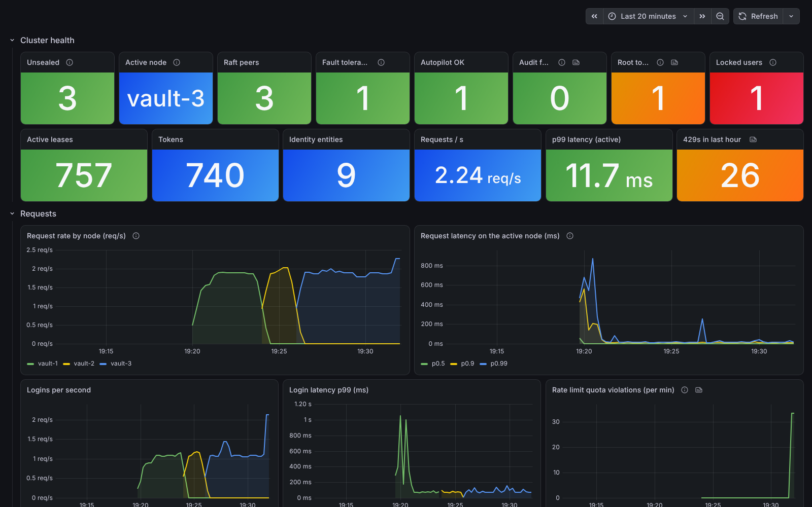

# Metrics: Prometheus and Grafana

[Back to README](../README.md) · [Access](access.md) · [Architecture](architecture.md) · [SIEM](siem.md) · [Upgrades](upgrades.md) · [Multi-cloud](multicloud.md) · [Terraform](terraform.md) · [OIDC](oidc.md) · [Exercises](exercises.md)



## Telemetry configuration

From `vault/config/vault.hcl`:

```hcl
listener "tcp" {
  address = "0.0.0.0:8200"
  telemetry {
    unauthenticated_metrics_access = true   # standbys answer too
  }
}

telemetry {
  prometheus_retention_time = "24h"   # 0 disables the Prometheus endpoint
  disable_hostname          = true
  usage_gauge_period        = "1m"    # token, entity and secret counts (default 10m)
}
```

Scrape job in `prometheus/prometheus.yml`:

```yaml
- job_name: vault
  metrics_path: /v1/sys/metrics
  params: { format: [prometheus] }
  static_configs:
    - targets: ["vault-1:8200", "vault-2:8200", "vault-3:8200"]
```

For production, remove `unauthenticated_metrics_access` and give Prometheus a token whose policy has `read` on `sys/metrics` (`authorization: { credentials_file: ... }`).

Notes from building the dashboard:

- Vault summaries (`vault_core_handle_request` and similar) come with `quantile` labels 0.5, 0.9 and 0.99 in milliseconds, plus `_count` and `_sum`.
- Usage gauges (`vault_token_count`, `vault_identity_entity_count`, `vault_secret_kv_count`) are only emitted by the active node, once per `usage_gauge_period`. They show "No data" for the first minute or two.
- Some series exist only after the first event: `vault_quota_rate_limit_violation`, `vault_core_locked_users`.
- `vault_core_active` is 1 on the active node and 0 on standbys, which is how the dashboard finds the leader.

## Grafana dashboard

`grafana/dashboards/vault-overview.json` is generated by `grafana/build_dashboard.py`. Edit the script, run `python3 grafana/build_dashboard.py`, and Grafana reloads the file.

### Cluster health

| Panel | Query | Why it matters |
|---|---|---|
| Unsealed | `sum(vault_core_unsealed)` | vault.core.unsealed summed over nodes. Any node at 0 during normal operation needs attention. |
| Active node | `vault_core_active == 1` | The node reporting vault.core.active = 1. |
| Raft peers | `max(vault_raft_peers)` |  |
| Fault tolerance | `max(vault_autopilot_failure_tolerance)` | How many voters can fail before quorum is lost (autopilot). |
| Autopilot OK | `max(vault_autopilot_healthy)` |  |
| Audit fails 1h | `round(sum(increase(vault_audit_log_request_failure[1h])) + sum(increase(vault_audit_log_response_failure[1h])))` | If every audit device fails, Vault stops serving requests. |
| Root tokens 24h | `round(sum(increase(vault_token_create_root[24h])))` | vault.token.create_root. Alert on any change. |
| Locked users | `max(vault_core_locked_users) or vector(0)` | userpass/LDAP/AppRole user lockout after repeated failed logins (default 5 attempts, 15 min). |
| Active leases | `sum(vault_expire_num_leases)` |  |
| Tokens | `sum(vault_token_count)` |  |
| Identity entities | `sum(vault_identity_entity_count)` |  |
| Requests / s | `sum(rate(vault_core_handle_request_count[1m]))` |  |
| p99 latency (active) | `max(vault_core_handle_request{quantile="0.99"} * on(instance) group_left() (vault_core_active == 1))` |  |
| 429s in last hour | `round(sum(increase(vault_quota_rate_limit_violation[1h]))) or vector(0)` |  |

### Requests

| Panel | Query | Why it matters |
|---|---|---|
| Request rate by node (req/s) | `rate(vault_core_handle_request_count[1m])` | vault.core.handle_request. Standbys forward to the active node, so the active node carries the load. |
| Request latency on the active node (ms) | `max by (quantile) (vault_core_handle_request{quantile=~"0.5\|0.9\|0.99"} * on(instance) group_left() (vault_core_active == 1))` | Alert when latency rises more than 50% or 3 standard deviations above your baseline. |
| Logins per second | `rate(vault_core_handle_login_request_count[1m])` |  |
| Login latency p99 (ms) | `vault_core_handle_login_request{quantile="0.99"}` |  |
| Rate limit quota violations (per min) | `sum by (name) (increase(vault_quota_rate_limit_violation[1m]))` | quota.rate_limit.violation. Clients get HTTP 429. The lab generates a burst about every 10 minutes. |
| In-flight requests | `vault_core_in_flight_requests` |  |
| Audit log writes per second | `rate(vault_audit_log_request_count[1m])`<br>`rate(vault_audit_log_response_count[1m])` |  |
| Requests forwarded by standbys (per s) | `rate(vault_ha_rpc_client_forward_count[1m])` |  |

### Usage and capacity

| Panel | Query | Why it matters |
|---|---|---|
| Active leases | `vault_expire_num_leases` | vault.expire.num_leases. A steady climb is a lease explosion: shorten TTLs or use batch tokens. |
| Tokens by policy | `sum by (policy) (vault_token_count_by_policy)` |  |
| Token creation by auth method (per min) | `sum by (auth_method) (rate(vault_token_creation[5m])) * 60` |  |
| Identity entities | `sum(vault_identity_entity_count)` | Large entity and group counts slow ACL evaluation. |
| KV secrets by mount | `sum by (mount_point) (vault_secret_kv_count)` |  |
| Irrevocable leases | `sum(vault_expire_num_irrevocable_leases)` | Leases Vault could not revoke. A rising count needs investigation. |

### Integrated Storage (Raft)

| Panel | Query | Why it matters |
|---|---|---|
| Leader last contact p99 (ms) | `vault_raft_leader_lastContact{quantile="0.99"}` | Time since the leader last heard from followers. Rising values mean network or disk trouble. |
| Follower heartbeat age (ms) | `vault_raft_storage_follower_last_heartbeat_ms` |  |
| Raft commit time p99 (ms) | `vault_raft_commitTime{quantile="0.99"}` |  |
| Applied index by node | `vault_raft_storage_stats_applied_index` | Followers should track the leader closely. |
| Storage put / get p99 (ms) | `vault_raft_storage_put{quantile="0.99"}`<br>`vault_raft_storage_get{quantile="0.99"}` |  |
| BoltDB freelist used (bytes) | `sum by (node) (vault_raft_storage_bolt_freelist_used_bytes)` |  |

### Runtime

| Panel | Query | Why it matters |
|---|---|---|
| Memory from the OS (sys_bytes) | `vault_runtime_sys_bytes` | Add memory when it passes 90% of the host. |
| GC pause (seconds per minute) | `rate(vault_runtime_total_gc_pause_ns[2m]) * 60 / 1e9` | HashiCorp guidance: warn above 2 s per minute, critical above 5 s. |
| Goroutines | `vault_runtime_num_goroutines` |  |

## Alert rules

`prometheus/rules/vault-alerts.yml`, visible at http://localhost:9090/alerts. Thresholds follow HashiCorp Validated Designs, "Monitoring and observability".

| Alert | Expression | For | Severity |
|---|---|---|---|
| VaultNodeSealed | `vault_core_unsealed == 0` | 1m | critical |
| VaultNodeDown | `up{job="vault"} == 0` | 1m | critical |
| VaultNoActiveNode | `sum(vault_core_active) < 1` | 1m | critical |
| VaultLeadershipLost | `increase(vault_core_leadership_lost_count[10m]) > 0` | 0m | warning |
| VaultRaftFailureToleranceZero | `max(vault_autopilot_failure_tolerance) < 1` | 2m | warning |
| VaultAuditFailure | `increase(vault_audit_log_request_failure[5m]) > 0 or increase(vault_audit_log_response_failure[5m]) > 0` | 0m | critical |
| VaultRootTokenCreated | `increase(vault_token_create_root[5m]) > 0` | 0m | warning |
| VaultRequestLatencyHigh | `vault_core_handle_request{quantile="0.99"} > 500` | 5m | warning |
| VaultGCPauseHigh | `rate(vault_runtime_total_gc_pause_ns[2m]) * 60 / 1e9 > 2` | 5m | warning |
| VaultLeaseCountHigh | `sum(vault_expire_num_leases) > 250000` | 15m | warning |
| VaultRateLimitViolations | `sum(increase(vault_quota_rate_limit_violation[5m])) > 0` | 0m | info |

To add one, edit the file and reload: `curl -X POST localhost:9090/-/reload`. There is no Alertmanager in the lab; add one if you want notifications.

## Sources

- [Vault telemetry configuration](https://developer.hashicorp.com/vault/docs/configuration/telemetry)
- [Vault key metrics](https://developer.hashicorp.com/vault/docs/internals/telemetry/key-metrics)
- [HashiCorp Validated Designs: monitoring and observability](https://developer.hashicorp.com/validated-designs/vault/administration-guide/monitoring-and-observability)
