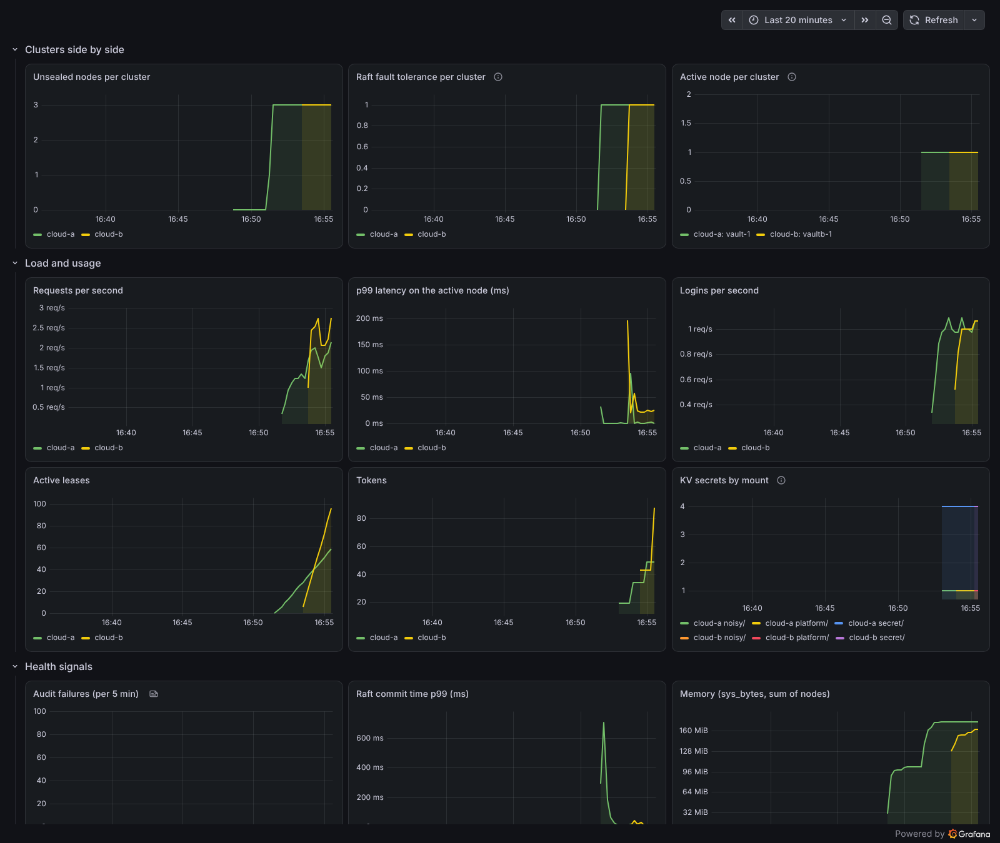
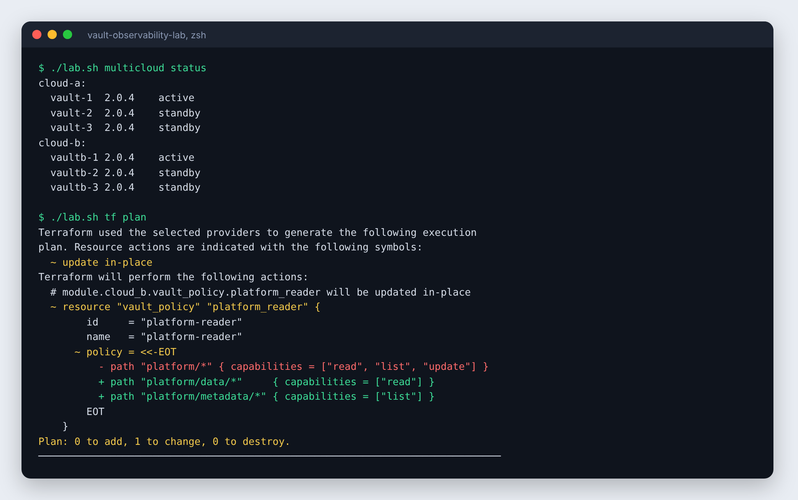

# Multi-cloud with independent clusters

[Back to README](../README.md) · [Access](access.md) · [Architecture](architecture.md) · [Upgrades](upgrades.md) · [Exercises](exercises.md)



One 3-node Raft cluster is the building block for one region of one cloud. A company on several clouds runs several of those blocks, and the design question is how they relate. This page lists the patterns, then shows the one Community Edition can do well (independent clusters, kept identical with Terraform) running in the lab.

## The patterns

| Pattern | Edition | How it works | Good when | Watch out for |
|---|---|---|---|---|
| One central cluster | Community or Enterprise | One cluster in one cloud; workloads elsewhere reach it over VPN, interconnect or private link | One source of truth matters most, moderate traffic | Every read from another cloud crosses clouds: latency, egress cost, and the home cloud is a shared failure domain. Vault Agent or Proxy caching softens it. |
| Independent cluster per cloud | Community | AWS workloads use the AWS cluster, Azure the Azure cluster; dynamic secrets are issued locally | Most secrets are local anyway (cloud credentials, database users, certificates) | No native replication. Configuration and shared static secrets must be kept in sync with Terraform or CI. |
| One Raft cluster stretched across clouds | Either | Voters in different clouds form one quorum | Almost never | Raft needs low latency between voters. Every write waits for a cross-cloud round trip, and a link failure can cost quorum. Keep each Raft cluster within one region. |
| Replicated clusters | Enterprise | A performance primary in one cloud, performance secondaries in the others (local reads and auth), DR secondaries for failover | Global companies needing local performance, one secrets namespace, warm DR | License cost and operational maturity |

Inside each cluster everything else in this lab applies unchanged: rolling upgrades, CI/CD integration with each cloud's native auth method (`aws`, `azure`, `gcp`, Kubernetes per cluster), metrics and audit logging.

## What the lab simulates

`./lab.sh multicloud up` starts a second, fully independent cluster called cloud-b next to the main one (cloud-a):

| | cloud-a | cloud-b |
|---|---|---|
| Nodes | vault-1, vault-2, vault-3 | vaultb-1, vaultb-2, vaultb-3 |
| Ports | 8200, 8210, 8220 | 8300, 8310, 8320 |
| Stands for | `aws-us-east-1` | `azure-westeurope` |
| Root token | `./lab.sh token` | `./lab.sh token b` |
| Unseal keys, tokens | `secrets/` | `secrets/cloud-b/` |
| Logs (Wazuh) | `/var/log/vault/` | `/var/log/vault-b/` |
| Prometheus label | `cluster="cloud-a"` | `cluster="cloud-b"` |

The two clusters share nothing: different Raft storage, unseal keys, root tokens and audit logs. cloud-b gets the same seed as cloud-a and its own load generator, so both have traffic.

What the lab cannot simulate: real cross-cloud latency, cloud-native auth (`aws`, `azure` auth methods need real cloud identities), and private connectivity. The patterns above still hold; the lab shows the operational side.

## Commands

```bash
./lab.sh multicloud up        # start cloud-b (about 30 seconds); Prometheus and Wazuh pick it up
./lab.sh multicloud status    # version and role of every node in both clusters
./lab.sh tf apply             # apply the Terraform baseline to both clusters
./lab.sh tf plan              # show drift between the code and either cluster
./lab.sh incident b           # simulated attack against cloud-b
./lab.sh multicloud down      # stop cloud-b, keep its data
```

Talk to cloud-b with the CLI:

```bash
export VAULT_ADDR=http://localhost:8300
export VAULT_TOKEN=$(./lab.sh token b)
vault operator raft list-peers
vault kv get -mount=platform config/cluster
```

## Terraform: one baseline, every cluster

`terraform/multicloud` declares one provider per cluster and applies the same module to each:

```hcl
module "cloud_a" {
  source    = "./modules/baseline"
  providers = { vault = vault.cloud_a }
  cluster   = "cloud-a"
  region    = "aws-us-east-1"
}

module "cloud_b" {
  source    = "./modules/baseline"
  providers = { vault = vault.cloud_b }
  cluster   = "cloud-b"
  region    = "azure-westeurope"
}
```

The baseline module creates, in every cluster:

- KV v2 mount `platform/` and a secret `platform/config/cluster` with the cluster name and region (the only per-cluster values)
- policies `platform-reader` and `platform-deployer`
- AppRole auth at `approle-platform` with role `deployer` (20 minute tokens)
- a rate limit quota of 50 requests per second on `platform/`

`./lab.sh tf` runs a local `terraform` if one is installed, otherwise the `hashicorp/terraform` image on the lab network. The tokens come from the lab's secrets; nothing is stored in the Terraform files. State stays local in `terraform/multicloud/` (git-ignored).

Adding a third cloud is one more provider block and one more module call.

## Drift detection

The value of the Terraform layer shows up when someone changes a cluster by hand. In the lab:

```bash
# someone "fixes" something directly on cloud-b
VAULT_ADDR=http://localhost:8300 VAULT_TOKEN=$(./lab.sh token b) \
  vault policy write platform-reader - <<'EOF'
path "platform/*" { capabilities = ["read", "list", "update"] }
EOF

./lab.sh tf plan
```



Terraform reports one change on cloud-b only, with the exact difference, and `./lab.sh tf apply` puts it back. In production, run `terraform plan -detailed-exitcode` on a schedule; exit code 2 means drift and can open a ticket or page someone. The same change also shows up in Wazuh as rule 100142 (policy changed), from `/var/log/vault-b/audit.log`.

## Monitoring several clusters

- Prometheus: one scrape job per cluster with a `cluster` label (cloud-b's targets come from `prometheus/targets/cloud-b.json`, written by `lab.sh`). The alert rules aggregate `by (cluster)`, so "no active node" or "fault tolerance 0" names the cluster.
- Grafana: the "Vault overview" dashboard has a Cluster selector; the "Vault multi-cloud" dashboard puts both clusters side by side (unsealed nodes, fault tolerance, active node, request rate, p99 latency, leases, tokens, KV secrets per mount, audit failures, commit time, memory).
- Wazuh: one manager reads both clusters' logs; the `location` field tells them apart. The Vault SIEM dashboard has an "Alerts by cluster" panel.

## Lessons from running it

- Terraform with the root token works, but every resource it reads or writes shows up in the SIEM as root token use (rule 100130). In production give Terraform its own auth (AppRole or JWT from CI) and a policy limited to the paths it manages.
- Newer Vault images (2.0) run as a non-root user by default. The lab's helper containers now run as root explicitly so they can write `./secrets`; check the same thing in your own images and scripts before upgrading.
- Independent clusters drift unless something checks. A scheduled `terraform plan` is the cheapest guard.

## Where this pattern stops

Independent clusters do not share secrets. A static secret that every cloud needs is written to each cluster (by Terraform, a pipeline, or the application team), and rotating it means rotating it everywhere. When that becomes the main pain, or you need cross-region DR with a recovery point of seconds, Enterprise replication or HCP Vault Dedicated (on AWS and Azure) is the next step. The usual Enterprise topology is a performance primary in one cloud, performance secondaries in the others, each with a DR secondary, behind one global DNS name.
