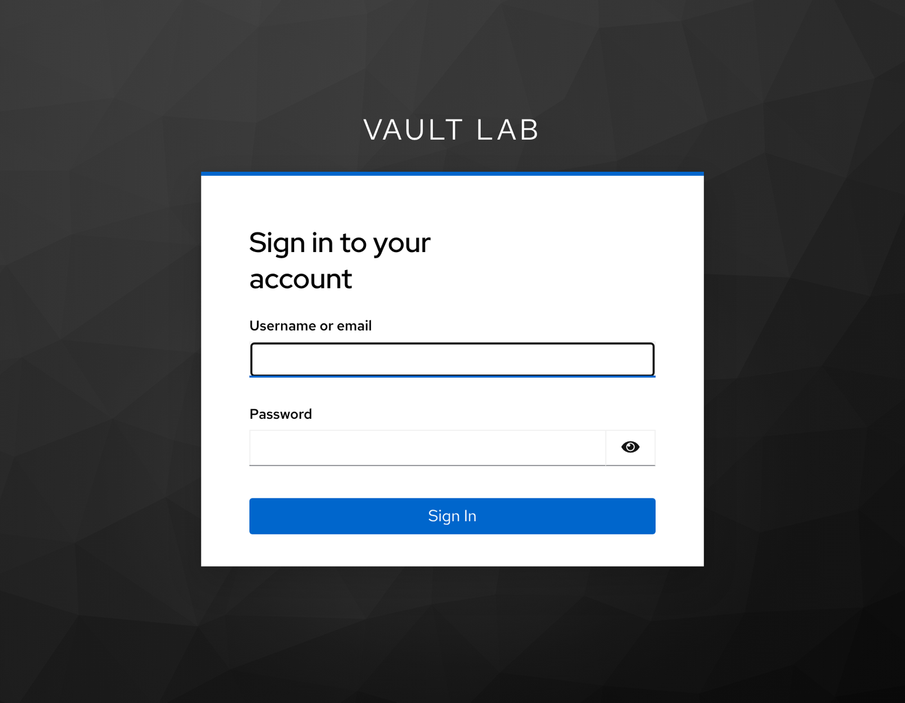
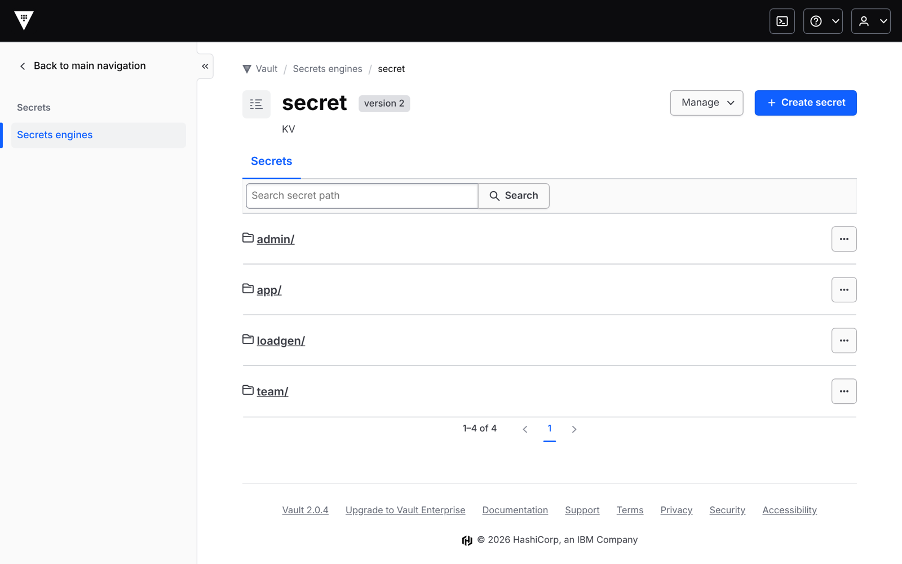
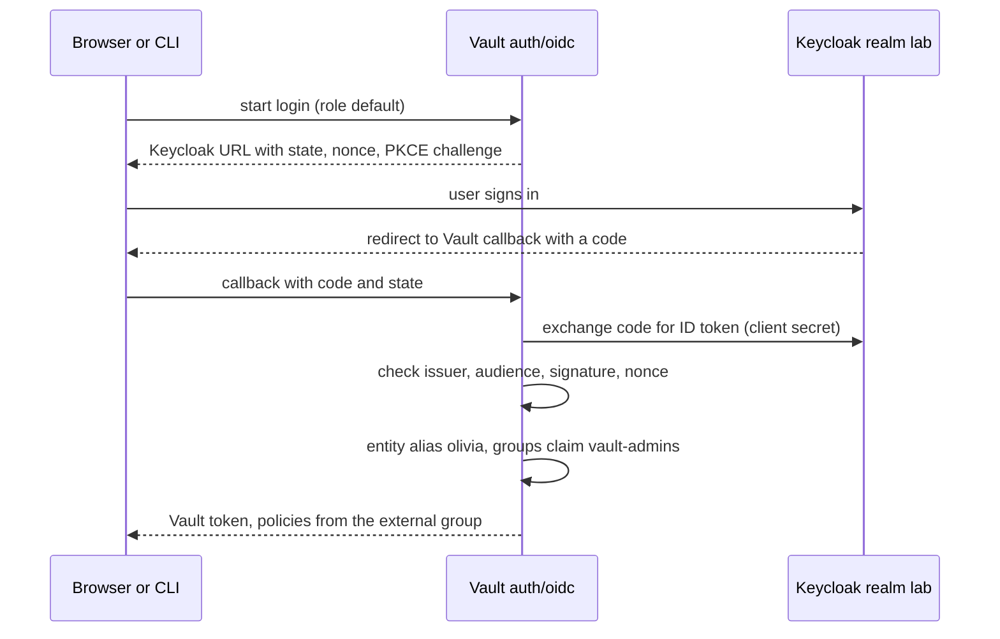

# OIDC logins with Keycloak

[Back to README](../README.md) · [Access](access.md) · [SIEM](siem.md) · [Exercises](exercises.md) · [Troubleshooting](troubleshooting.md)

People should not log in to Vault with userpass passwords or shared tokens. In most companies they log in through the identity provider they already use (Entra ID, Okta, Google, Keycloak), and their group membership there decides what they get in Vault. This page adds that to the lab with Keycloak, an open source OIDC provider that runs as one more container.

| Keycloak sign-in page (realm "lab"), opened from the Vault UI | The Vault UI after signing in as olivia |
|---|---|
|  |  |

## Start it

One-time step on your machine, so the browser can reach Keycloak by the same name the Vault containers use:

```bash
echo '127.0.0.1 keycloak' | sudo tee -a /etc/hosts
```

Then:

```bash
./lab.sh oidc up        # starts Keycloak, imports the realm, configures auth/oidc in Vault
./lab.sh oidc status
./lab.sh oidc down      # stops and removes Keycloak; auth/oidc stays configured in Vault
```

| What | Where |
|---|---|
| Keycloak admin console | http://keycloak:8180 (admin / admin) |
| Realm, client, groups, users | `oidc/realm-lab.json`, imported on start |
| Vault configuration | `oidc/configure-vault.sh`, run inside vault-1 by `./lab.sh oidc up` |
| Policy for admins | `oidc/secrets-admin.hcl` |

Keycloak runs in development mode with its database inside the container. `./lab.sh oidc down` removes the container, so the next `up` imports `realm-lab.json` fresh. Changes made in the admin console are lost at that point; put lasting changes in the JSON file.

## Users and what they get

| User | Password | Keycloak group | Vault policies after login |
|---|---|---|---|
| olivia | olivia-pass | vault-admins | `default`, `secrets-admin` (create, read, update, delete under `secret/`) |
| oscar | oscar-pass | vault-readers | `default`, `app` (read `secret/app/*`) |
| nora | nora-pass | none | login refused (see below) |

## Log in

```bash
export VAULT_ADDR=http://localhost:8200
vault login -method=oidc               # opens the browser; sign in as olivia
vault token lookup                     # display_name oidc-olivia, identity_policies [secrets-admin]
vault kv put secret/team/notes text=hello   # allowed for olivia
```

In the web UI: http://localhost:8200, method OIDC, leave the role empty, "Sign in with OIDC Provider". A Keycloak window opens; after sign-in it closes and the UI is logged in.

Log in as oscar and the same `kv put` returns 403, while `vault kv get secret/app/config` works.

## How it fits together



The Vault side, from `oidc/configure-vault.sh`:

```bash
vault auth enable oidc
vault write auth/oidc/config \
  oidc_discovery_url="http://keycloak:8180/realms/lab" \
  oidc_client_id=vault oidc_client_secret=vault-lab-oidc-secret \
  default_role=default

# role: who the user is, where their groups are, where the browser may come back to
vault write auth/oidc/role/default - <<'JSON'
{
  "user_claim": "preferred_username",
  "groups_claim": "groups",
  "claim_mappings": { "preferred_username": "username", "email": "email" },
  "oidc_scopes": ["profile", "email"],
  "allowed_redirect_uris": ["http://localhost:8250/oidc/callback",
                            "http://localhost:8200/ui/vault/auth/oidc/oidc/callback"],
  "token_policies": ["default"],
  "token_ttl": "1h"
}
JSON

# policies come from Keycloak groups: one external group per IdP group, linked by an alias
vault write identity/group/name/vault-admins type=external policies=secrets-admin
ACCESSOR=$(vault auth list -format=json | jq -r '."oidc/".accessor')
vault write identity/group-alias name=vault-admins mount_accessor=$ACCESSOR \
  canonical_id=$(vault read -field=id identity/group/name/vault-admins)
```

Points worth knowing:

- The role gives only `default`. Every other policy comes from the external group, so access is managed in one place: add someone to `vault-admins` in Keycloak and their next login carries `secrets-admin`, with no change in Vault. We tested it by moving oscar into `vault-admins`; his next token had `app` and `secrets-admin`.
- The group alias name must equal the value in the `groups` claim. The Keycloak mapper sends plain group names ("Full group path" off), so the alias is `vault-admins`, not `/vault-admins`.
- Group changes apply at the next login. A token issued before the change keeps its policies until it expires, which is one reason to keep `token_ttl` short for people.
- `user_claim` names the entity alias. `preferred_username` makes the audit log readable (`oidc-olivia`). In production use a claim that never changes or gets reused, such as `sub` or Entra ID's `oid`, and keep the readable name in `claim_mappings`, which lands in the token metadata and the audit log.
- Two redirect types: `localhost:8250` is the listener the CLI starts for one login; the `/ui/vault/auth/oidc/oidc/callback` URLs serve the web UI on each node. Both must be listed in the Keycloak client and in the Vault role, or Keycloak refuses with "Invalid parameter: redirect_uri".
- Vault uses PKCE and a nonce on every login, and checks issuer, audience (`vault`) and signature against Keycloak's published keys.

## Why the /etc/hosts line

Vault checks that the `iss` value in each ID token equals `oidc_discovery_url`. The Vault containers reach Keycloak at `http://keycloak:8180` on the Docker network. Your browser has to reach the same URL, because Keycloak puts that URL into the tokens it issues after you sign in through the browser. `localhost:8180` would work in the browser but not inside the containers; `keycloak:8180` works in both once your machine knows the name. Keycloak is started with `--hostname=http://keycloak:8180` so it always issues that URL.

This is the same problem in production when an IdP is reached through different names inside and outside a network. The issuer must be one URL that both Vault and the user's browser can reach.

## What the lab taught

- A user with no groups cannot log in. Keycloak leaves the `groups` claim out of the token when the user belongs to no group, and Vault refuses the login with `"groups" claim not found in token` whenever the role sets `groups_claim`. nora shows this. It is a safe default: no group, no access. If people without groups should get `default`, the IdP has to send an empty list, or they need a separate role without `groups_claim`.
- A failed OIDC login does not look like a failed userpass login in the audit log. The request path is `auth/oidc/oidc/callback`, not `auth/*/login`, and there is no top-level `error` field: the reason sits in `response.data.error`, HMAC-hashed like every other response value. The existing failed-login rule (100110) missed it, so the lab has two new Wazuh rules: 100112 (failed OIDC login, level 5) and 100113 (6 in 2 minutes, level 10). The dashboard's "Failed logins" panels count both.
- To learn why a particular login failed, hash the suspected message and compare: `vault write sys/audit-hash/file input='failed to fetch groups: "groups" claim not found in token'`.
- `claim_mappings` takes a map. Passed on the CLI as `claim_mappings="a=b,c=d"` it becomes one odd key; send JSON as above.

## Using another provider

Only `oidc_discovery_url`, the client ID and secret, and the group claim change:

| Provider | `oidc_discovery_url` | Groups |
|---|---|---|
| Keycloak | `https://<host>/realms/<realm>` | Group Membership mapper, claim `groups` |
| Entra ID | `https://login.microsoftonline.com/<tenant-id>/v2.0` | `groups` claim with group object IDs; alias names are the IDs; over 200 groups Entra sends an overage claim instead |
| Okta | `https://<org>.okta.com` or `https://<org>.okta.com/oauth2/<server-id>` | groups claim rule on the authorization server |
| Google | `https://accounts.google.com` | no groups claim; map users individually or use Google Workspace groups through the Vault plugin's `provider_config` |

For Entra ID add `"oidc_scopes": ["https://graph.microsoft.com/.default", "profile"]` only when using `provider_config` to fetch groups from Microsoft Graph; with fewer than 200 groups the claim in the token is enough.

## Sources

- [Vault JWT/OIDC auth method](https://developer.hashicorp.com/vault/docs/auth/jwt) and [OIDC provider setup guides](https://developer.hashicorp.com/vault/docs/auth/jwt/oidc-providers)
- [Vault identity: external groups](https://developer.hashicorp.com/vault/docs/secrets/identity#external-vs-internal-groups)
- [Keycloak: importing a realm](https://www.keycloak.org/server/importExport) and [hostname configuration](https://www.keycloak.org/server/hostname)
