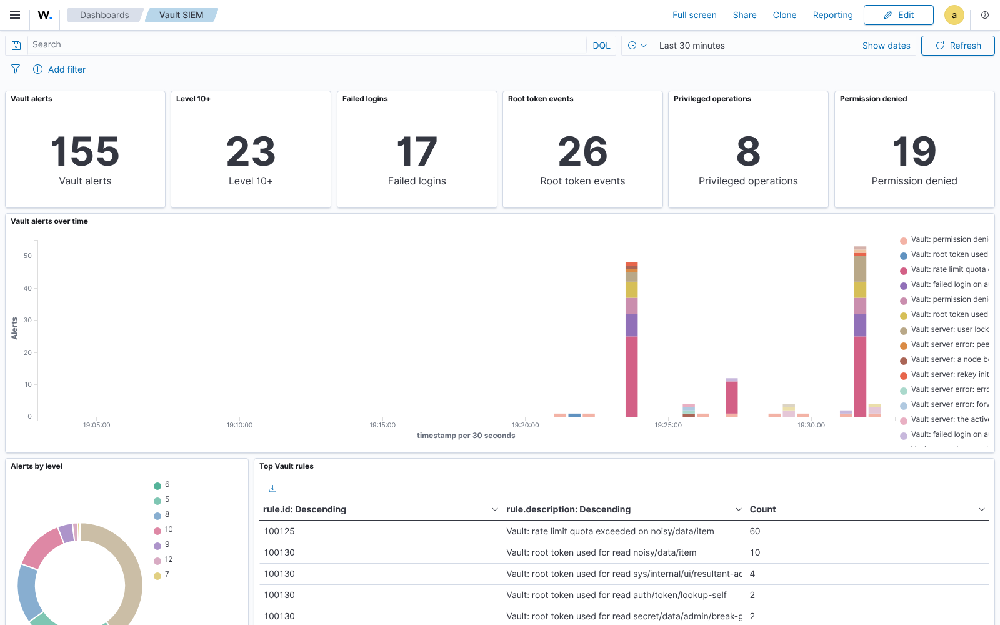

# SIEM: Wazuh

[Back to README](../README.md) · [Architecture](architecture.md) · [Metrics](metrics.md) · [Exercises](exercises.md)



## Pipeline

```
Vault file audit device  ->  /vault/logs/audit.log     \
Vault server log (JSON)  ->  /vault/logs/vault-N.log    >  shared volume (read-only in Wazuh)
                                                        /
Wazuh logcollector (log_format json) -> analysisd (vault_rules.xml) -> alerts -> indexer -> dashboard
```

From `wazuh/config/wazuh_cluster/wazuh_manager.conf`:

```xml
<localfile>
  <log_format>json</log_format>
  <location>/var/log/vault/audit.log</location>
  <label key="@source">vault-audit</label>
</localfile>
<localfile>
  <log_format>json</log_format>
  <location>/var/log/vault/vault-*.log</location>
  <label key="@source">vault-server</label>
</localfile>
```

Wazuh's built-in JSON decoder flattens each line, so rules can match fields such as `request.path`, `request.operation`, `auth.display_name`, `auth.policies`, `error`, `@message` and `@level`. In the indexer these appear as `data.request.path` and so on.

## Rules

`wazuh/rules/vault_rules.xml`. Normal traffic matches the level 0 base rules (decoded, not stored). Only findings become alerts.

| Rule | Level | Source | Fires on | MITRE |
|---|---|---|---|---|
| 100110 | 5 | audit | Failed login on any `auth/*/login` path | T1110 |
| 100111 | 10 | audit | 6 failed logins on the same path in 2 minutes | T1110 |
| 100120 | 5 | audit | Permission denied (not a login) | |
| 100121 | 9 | audit | Same identity denied 5 times in 1 minute | T1083 |
| 100125 | 6 | audit | Rate limit quota exceeded (429) | |
| 100130 | 8 | audit | Request made with a root token | T1078 |
| 100131 | 12 | audit | A new root token issued | T1078 |
| 100140 | 10 | audit | generate-root, rekey, rotate, seal, step-down, raw, replication | T1098 |
| 100141 | 12 | audit | Audit device enabled, changed or disabled | T1562.008 |
| 100142 | 9 | audit | ACL policy written or deleted | T1098 |
| 100143 | 9 | audit | Auth method or secrets engine enabled or disabled | |
| 100201 | 5 | server | Error in a server log (join retries before init are excluded) | |
| 100202 | 10 | server | Rekey or root generation started or cancelled | T1098 |
| 100203 | 10 | server | A node was sealed | |
| 100204 | 6 | server | A node became active | |
| 100206 | 7 | server | Raft heartbeat timeout, election started | |
| 100207 | 10 | server | User locked out after repeated failed logins | T1110 |
| 100208 | 7 | server | The active node stepped down (`vault operator step-down`) | |

## Things the lab taught

These came out of testing the rules against real Vault 1.19 logs:

- Vault writes a `request` and a `response` line for each call. The rules alert on `response` so each call counts once.
- A failed userpass login has `error: invalid credentials` on the request line and `error: permission denied` on the response line.
- Rekey (`sys/rekey/*`) never reaches the audit log because those endpoints are unauthenticated. `sys/generate-root/attempt` is audited, but without an identity. The server log records both (`rekey initialized`, `root generation initialized`).
- `sys/step-down` writes only a `request` line and no response, so the step-down is detected from the server log (`stepping down from active operation to standby`).
- Requests rejected by a rate limit quota produce only a `request` line, and only when `enable_rate_limit_audit_logging=true` is set on `sys/quotas/config`.
- Vault 1.13+ locks a userpass user out after 5 failures in 15 minutes by default. The lockout only shows in the server log (`login attempts exceeded, user is locked out`) and in the `vault_core_locked_users` metric.
- When several child rules match one event, Wazuh keeps the highest level. The levels are set so the more specific finding wins: a policy change made with a root token shows as a policy change (9), not as root token use (8).
- The Vault CLI makes preflight calls to `sys/internal/ui/mounts/*`. Rule 100130 skips them so root token use is not counted twice.

## Working with the rules

```bash
# test one log line against the loaded rules
docker compose exec wazuh.manager /var/ossec/bin/wazuh-logtest

# after editing wazuh/rules/vault_rules.xml
docker compose restart wazuh.manager

# watch alerts as they arrive
docker compose exec wazuh.manager tail -f /var/ossec/logs/alerts/alerts.json
```

## Dashboard

"Vault SIEM" (Wazuh > Dashboards) is generated by `wazuh/build_dashboard.py` into `wazuh/vault-siem-dashboard.ndjson` and imported by `./lab.sh up` or `./lab.sh dashboards`. Panels: headline counts (all alerts, level 10+, failed logins, root token events, privileged operations, permission denied), timeline by rule, alerts by level, top rules, identities, paths, failed logins by path and source, server log findings by node, and the event list.

In Threat Hunting, `rule.groups:vault` shows everything; `rule.groups:vault_root`, `vault_privileged`, `vault_server` narrow it down.
